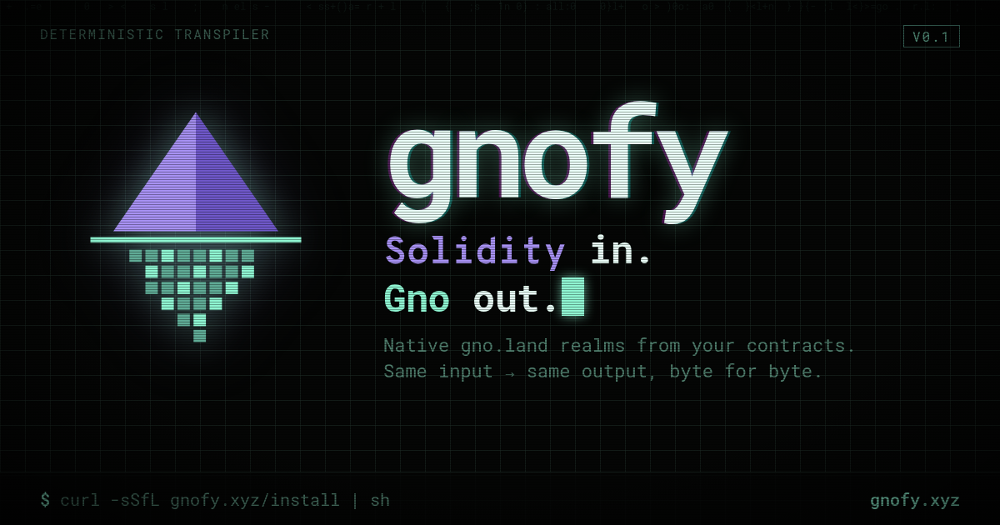

<p align="center">
  
</p>

# gnofy

**Solidity in, Gno out.**

`gnofy` takes Solidity `0.8.x` contracts and compiles them into native [gno.land](https://gno.land) realms. No emulated EVM, no bytecode wrapper — plain, readable Gno (Go 1.17 + Gno stdlib) that you can audit, test with `gno test`, and compose on-chain.

Same input → same output, byte for byte.

Website: **[gnofy.xyz](https://gnofy.xyz)**

---

## [00] // install

**Linux / macOS:**

```sh
curl -sSfL https://gnofy.xyz/install.sh | sh
```

**Windows (PowerShell):**

```powershell
irm https://gnofy.xyz/install.ps1 | iex
```

**Build from source (requires Go 1.27+):**

```sh
git clone https://github.com/gnofy-xyz/gnofy
cd gnofy
go build -o gnofy ./cmd/gnofy
```

### Toolchain requirements

`gnofy` shells out to the official compilers rather than reimplementing them:

- **`solc` or `solcjs` (`0.8.x`)** on your `PATH` (for AST & type resolution).
  Quick setup if you don't have native `solc`: `npm i -g solc` or `bun add -g solc`.
- **`gno`** on your `PATH` (needed for `gnofy verify` and `--ai=assist`).
  If you installed `gno` with the prebuilt installer script, point `GNOROOT` to the Gno stdlibs once so `gno test` can resolve `chain`, `strconv`, and `testing`:
  ```sh
  git clone --depth=1 --branch v1.8.0 https://github.com/gnolang/gno ~/.gno/src
  export GNOROOT="$HOME/.gno/src"
  export PATH="$HOME/.gno/bin:$PATH"
  ```

---

## [01] // cli

Three commands: `analyze`, `convert`, and `verify`. Flags work before or after the path.

### Audit a project before touching code

```sh
gnofy analyze ./contracts
gnofy analyze --json ./contracts
```

Walks the `solc` AST and prints what translates cleanly, what needs attention (`Warn`: hardcoded `0x...` addresses, `payable`, dynamic `IERC20(addr)` casts, constructors with args), and what has no 1:1 equivalent (`Hole`: `assembly`/Yul, `delegatecall`, `try/catch`, `int256`).

Foundry projects (`foundry.toml` + `remappings.txt`) are picked up automatically. Standalone files importing common `@openzeppelin/*` or `@prb/math/*` contracts also work out of the box via built-in shims (disable with `--no-shims`).

### Transpile deterministically

```sh
# 1:1 deterministic mode (default, zero network calls)
gnofy convert ./contracts/Counter.sol -o ./out/counter

# Idiomatic gno.land mode: ERC-20 -> native GRC-20 + Ownable, live Markdown Render()
gnofy convert --idiomatic ./contracts/SimpleERC20.sol -o ./out/erc20

# Convert and immediately run `gno test`
gnofy convert ./contracts/Vault.sol -o ./out/vault --verify
```

### Verify generated realms

```sh
gnofy verify ./out/counter
```

### Optional surgical AI (`--ai=assist`)

By default (`--ai=off`), `gnofy` makes **zero network calls** and emits explicit `panic("TODO(gnofy): ...")` stubs wherever a `Hole` appears.

If you want to resolve isolated holes (like inline `assembly` blocks) using your own OpenAI-compatible server (Ollama, LM Studio, llama.cpp, vLLM, OpenRouter, OpenAI, or any self-hosted `/v1/chat/completions` endpoint):

```sh
# Local server (e.g. Ollama)
gnofy convert ./contracts/Disperse.sol -o ./out/disperse \
  --ai=assist \
  --ai-endpoint=http://localhost:11434/v1 \
  --ai-model=qwen2.5-coder:7b

# Custom / self-hosted OpenAI-compatible server with API key
export GNOFY_AI_ENDPOINT="https://your-llm.example.com/v1"
export GNOFY_AI_MODEL="your-model-name"
export GNOFY_AI_API_KEY="your-api-key"

gnofy convert ./contracts/Disperse.sol -o ./out/disperse --ai=assist
```

You can also pass `--ai-api-key` directly as a flag (or use `OPENAI_API_KEY`). Secrets are never echoed in `-h` help output.

How `--ai=assist` stays predictable:
- **Only isolated `Hole` nodes** are sent to the model — never the whole contract.
- **`gno test` verification is mandatory** in `--ai=assist` mode. If compilation fails, `gnofy` retries up to `--max-retries` (default `2`) with the compiler error. If it still fails, it reverts cleanly to safe `TODO(gnofy)` stubs.
- Verified resolutions are pinned by hole hash in `gnofy.lock` and wrapped with `// BEGIN gnofy-ai` / `// END gnofy-ai` markers. Subsequent runs (and CI) reuse the lockfile with zero LLM calls.

---

## [02] // pipeline

```text
.sol ──► solc (--standard-json)
     ──► analyzer (auto / warn / hole)
     ──► ir lowering
     ──► passes: c3flatten → modifiers → crossing → naming [→ standards]
     ──► codegen (strict Go 1.17 + Gno stdlib)
     ──► verify (gno test)
```

Key design choices:
- **Host vs target split:** `gnofy` itself is written in Go 1.27, while emitted code strictly targets **Gno (Go 1.17)** — no generics, no `min`/`max`/`clear`, no goroutines or channels.
- **Exact-width checked arithmetic (`solrt`):** `uint8`/`16`/`32`/`64` and `int8`/`16`/`32`/`64` use width-exact overflow checks; `uint72`..`uint248` (`uint96`, `uint128`, etc.) enforce `.CheckBits(N)` so overflows revert at $2^N$ instead of $2^{256}$; `uint256` uses 256-bit `U256` with 512-bit `MulDiv`.
- **Inheritance & base constructors:** C3 linearization flattens `virtual`/`override`/`super` and chains base constructors in Solidity's base-to-derived order.
- **Anti-front-running `Init`:** parameterized Solidity constructors become `Init(cur realm, ...)` guarded fail-closed by `deployer` captured in `func init(cur realm)` during deployment.
- **Deterministic state maps:** Solidity `mapping`s compile to a pure-Gno AVL `OrderedMap` with zero-value defaults and collision-free `KeyJoin` for nested mappings.
- **Zero-dependency output by default:** `solrt` is embedded into `solrt_gen.gno` so generated realms pass `gno test` offline immediately. Pass `--runtime-import=gno.land/p/gnofy/solrt` to import a shared on-chain package instead.

---

## [03] // where to look

Don't trust a transpiler blindly — read it:

- `internal/frontend/solc/` — `solc`/`solcjs` standard-json runner, Foundry remappings, built-in library shims, typed AST.
- `internal/analyzer/` — migrability scanner, standard detection, CLI/JSON reports.
- `internal/ir/` — intermediate representation and AST lowering.
- `internal/passes/` — deterministic IR passes (`c3flatten`, `modifiers`, `crossing`, `naming`, `standards`).
- `internal/codegen/gno/` — Go 1.17 / Gno emitter, idiomatic GRC-20 & Markdown `Render()` generator.
- `internal/ai/` — the only network code in the repo. Off unless you pass `--ai=assist`.
- `gno/p/solrt/` — pure-Gno runtime (`U256`, `MulDiv`, exact-width signed/unsigned checked math, `OrderedMap`, `ERC20Token` adapter).
- `testdata/` — contract corpus and full behavioral test suites executed on a real GnoVM.

Run the full test suite (including live GnoVM functional tests when `gno` + `GNOROOT` are present):

```sh
go test -v ./...
```

---

## [04] // known limitations (beta)

`gnofy` is currently in early beta. Everything below is either flagged explicitly by `gnofy analyze` or emitted as a `Hole` instead of silently changing contract semantics:

- **Wide signed integers (`int72`..`int256`):** flagged as `UNSUPPORTED_WIDE_SIGNED_INT` holes until a full `solrt.I256` is implemented (never silently truncated to `int64`).
- **Low-level EVM constructs:** inline `assembly` (Yul), `delegatecall` / EVM proxies, `create`/`create2`, `selfdestruct`, `try/catch` partial rollbacks, and `fallback()`/`receive()` become explicit `Hole` nodes.
- **ABI encoding & hashing:** `keccak256`, `abi.encode*`, and complex `bytes32` packing don't have full `solrt` helpers yet.
- **Arbitrary cross-contract calls:** `IERC20` / `SafeERC20` calls are wired through `solrt.ERC20Token`; other external contract interfaces need manual Gno package/registry wiring.
- **Live `--ai=assist` prompt tuning:** the OpenAI-compatible HTTP client, `gnofy.lock`, and bounded `gno test` repair loop are covered by automated tests, but live testing against different self-hosted models is still ongoing. If your model produces Gno 1.17 quirks on a real contract, open an issue with the snippet.

---

## [05] // license

[MIT](LICENSE) — Copyright (c) 2026 Aber DEV ([gnofy.xyz](https://gnofy.xyz)).
